# Partie 3 — Visualising Acceptability Degree Spaces

**Sémantique weighted h-categorizer : convergence, enveloppe convexe et cartes de densité**

*Auteur : Mohamed Amine Benhamaid*

📄 [Version courte du rapport (PDF, 5 pages)](docs/partie3/rapport_partie3.pdf) · 📓 [Notebook](notebooks/partie3.ipynb) · Code : [`src/part3/`](src/part3) · Tests : [`tests/test_part3_hcategorizer.py`](tests/test_part3_hcategorizer.py) · Figures : [`results/part3/`](results/part3)

> **Résumé.** Nous implémentons la sémantique *weighted h-categorizer* avec un critère d'arrêt
> paramétré par $\varepsilon>0$, puis nous étudions l'espace des degrés d'acceptabilité
> $S=\mathrm{HCat}([0,1]^{|A|})$ en échantillonnant 100 000 vecteurs de poids uniformes pour
> 17 frameworks de 2 à 6 arguments. Nous montrons que $S$ admet une description exacte,
> $\lbrace x\ge 0 : x_a(1+\sum_{b\to a}x_b)\le 1\rbrace$, et que la densité des points échantillonnés
> vaut $\lvert\det J_g(x)\rvert$. Cela fournit une vérité terrain pour juger l'enveloppe convexe,
> qui surestime $S$ de 7 % (2 arguments) à 22 % (6 arguments), et les cartes de densité.
> Celles-ci sont robustes au ré-échantillonnage, avec une erreur qui décroît en $1/\sqrt N$
> (environ 4 % en variation totale pour $N=100\,000$).

---

## Sommaire

- [Lancer le code](#lancer-le-code)
- [1. Sémantique weighted h-categorizer](#1-sémantique-weighted-h-categorizer)
  - [1.1 Définition](#11-définition) · [1.2 Implémentation](#12-implémentation) · [1.3 Tests](#13-tests-sur-de-petits-frameworks) · [1.4 Convergence et rôle de ε](#14-convergence-et-rôle-de-ε)
- [2. Espace des degrés d'acceptabilité](#2-espace-des-degrés-dacceptabilité)
  - [2.1 Protocole](#21-protocole-expérimental) · [2.2 Description exacte de S](#22-description-exacte-de-lespace-s) · [2.3 Résultats globaux](#23-résultats-globaux) · [2.4 Enveloppe convexe](#24-analyse-de-lenveloppe-convexe) · [2.5 Cartes de densité](#25-analyse-des-cartes-de-densité) · [2.6 Ré-échantillonnage](#26-résilience-au-ré-échantillonnage)
- [3. Conclusion](#3-conclusion)
- [Annexe : figures pour l'ensemble des frameworks](#annexe--figures-pour-lensemble-des-frameworks)

---

## Lancer le code

```
src/part3/
├── hcategorizer.py     # ArgumentationFramework + h_categorizer / h_categorizer_batch
├── frameworks.py       # catalogue (chaîne, cycle, étoile, complet, aléatoire) + parseur "a,b : a>b"
├── space.py            # échantillonnage, densité exacte, enveloppe convexe, heat-maps, métriques
└── run_experiments.py  # lance toutes les expériences et produit les figures
notebooks/partie3.ipynb            # le même code sous forme de notebook (mêmes résultats)
tests/test_part3_hcategorizer.py   # 19 tests unitaires
results/part3/                     # figures (.png) + tableau récapitulatif (summary.md)
docs/partie3/                      # rapport PDF
```

Dépendances : `numpy`, `scipy`, `matplotlib`, `pytest` (et `jupyter` pour le notebook).

```bash
pip install numpy scipy matplotlib pytest

python -m pytest tests -q                                          # 19 tests
python -m src.part3.run_experiments                                # toutes les expériences (N = 100 000, ~30 min)
python -m src.part3.run_experiments --quick                        # test rapide (N = 5 000)
python -m src.part3.run_experiments --af "a,b,c : a>b, b>c, c>a"   # un framework (A, R) quelconque
```

Options : `--n-samples` (100 000 par défaut), `--repeats` (10 ré-échantillonnages), `--epsilon` (1e-10).
Les figures et le tableau sont écrits dans `results/part3/`. Le notebook
[`notebooks/partie3.ipynb`](notebooks/partie3.ipynb) contient le même code avec les mêmes graines et
produit des résultats identiques.

```python
from src.part3.frameworks import parse
from src.part3.hcategorizer import h_categorizer

af = parse("a,b,c : a>b, b>c, c>a")                     # cycle à 3
h_categorizer(af, {"a": 1, "b": 1, "c": 1}, epsilon=1e-10)
# -> 0.6180339887... pour a, b et c                    (1/φ, nombre d'or)
```

---

## 1. Sémantique weighted h-categorizer

### 1.1 Définition

Un framework d'argumentation pondéré est un triplet $(A,R,w)$, où $A$ est un ensemble fini
d'arguments, $R\subseteq A\times A$ une relation d'attaque et $w:A\to[0,1]$ un poids initial.
On note $\mathrm{Att}(a)=\lbrace b \mid (b,a)\in R\rbrace$. La sémantique weighted h-categorizer
(Amgoud *et al.*, 2017) associe à chaque argument le degré

$$
\mathrm{Deg}(a) = \frac{w(a)}{1+\sum_{b\in\mathrm{Att}(a)}\mathrm{Deg}(b)} \qquad (1)
$$

unique solution de ce système, obtenue comme limite de la suite

$$
f^0(a)=w(a), \qquad f^{k+1}(a) = \frac{w(a)}{1+\sum_{b\in\mathrm{Att}(a)} f^k(b)} \qquad (2)
$$

On arrête l'itération dès que $\max_{a\in A}\lvert f^{k+1}(a)-f^k(a)\rvert<\varepsilon$.

### 1.2 Implémentation

Le code est dans [`src/part3/hcategorizer.py`](src/part3/hcategorizer.py). La relation $R$ est stockée
dans une matrice $M\in\lbrace 0,1\rbrace^{n\times n}$ avec $M_{ba}=1$ si et seulement si $b$ attaque $a$.
La somme des degrés des attaquants de tous les arguments s'écrit alors $xM$. On peut ainsi traiter
**simultanément** $N$ vecteurs de poids, rangés en lignes dans une matrice $W$ :

```python
def h_categorizer_batch(af, W, epsilon=1e-8, max_iter=100_000):
    if epsilon <= 0:
        raise ValueError("epsilon must be > 0")
    M, x = af.matrix, W.copy()
    for k in range(1, max_iter + 1):
        x_new = W / (1.0 + x @ M)          # equation (2) for all rows at once
        delta = np.max(np.abs(x_new - x))
        x = x_new
        if delta < epsilon:
            return x
    raise RuntimeError("no convergence")
```

La fonction `h_categorizer(af, weights, epsilon)` traite un seul vecteur, donné sous forme de
dictionnaire ou de liste. Un framework quelconque $(A,R)$ peut être passé en ligne de commande sous
la forme `"a,b,c : a>b, b>c"`. Grâce à la vectorisation, le calcul des 100 000 vecteurs prend entre
0,02 s et 0,4 s selon le framework.

### 1.3 Tests sur de petits frameworks

Les tests ([`tests/test_part3_hcategorizer.py`](tests/test_part3_hcategorizer.py), 19 tests, tous
réussis) comparent le résultat à une forme close, calculée avec $\varepsilon=10^{-12}$ :

| Framework | Forme close vérifiée |
|---|---|
| $a$, $b$ sans attaque | $\mathrm{Deg}=w$ |
| $a\to b$ | $\mathrm{Deg}(a)=w_a$, $\mathrm{Deg}(b)=w_b/(1+w_a)$ |
| $a\leftrightarrow b$ | $x_a-x_b=w_a-w_b$ et $x_b(1+x_a)=w_b$ ; pour $w\equiv 1$ : $x=(\sqrt5-1)/2\approx 0{,}618$ |
| $a\to a$ (auto-attaque) | $x=(-1+\sqrt{1+4w})/2$ |
| chaîne $a\to b\to c$, $w\equiv1$ | $(1,\ 1/2,\ 2/3)$ |
| cycle de longueur 3, $w\equiv1$ | $\mathrm{Deg}\equiv\varphi^{-1}=0{,}618$ (nombre d'or) |
| étoile $a,b\to c$ | $\mathrm{Deg}(c)=w_c/(1+w_a+w_b)$ |
| 20 graphes aléatoires (6 arg.) | le résultat est un point fixe de (1) et $0\le\mathrm{Deg}\le w$ |
| divers | $w(a)=0\Rightarrow\mathrm{Deg}(a)=0$ ; version batch = version unitaire ; $\varepsilon\le 0$ et poids hors de $[0,1]$ rejetés |

### 1.4 Convergence et rôle de ε

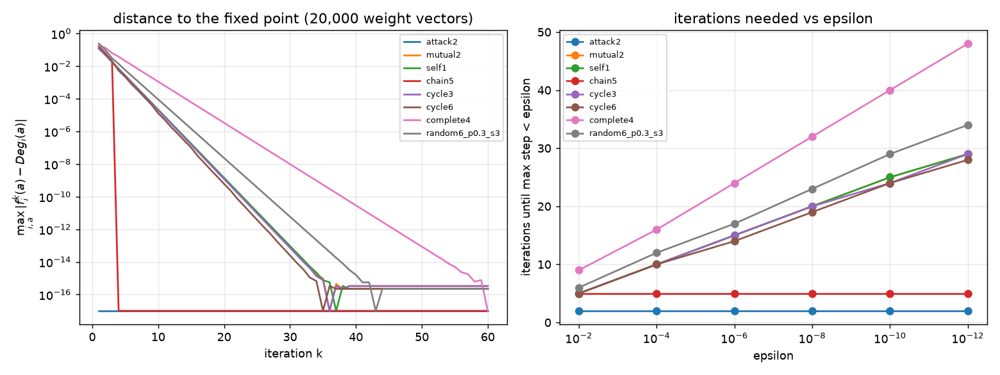

*À gauche : distance au point fixe en fonction de l'itération, pour 20 000 vecteurs de poids traités
ensemble (échelle logarithmique). À droite : nombre d'itérations nécessaires en fonction de $\varepsilon$.*

Nombre d'itérations jusqu'à ce que le pas maximal soit inférieur à $\varepsilon$ :

| $\varepsilon$ | $10^{-2}$ | $10^{-4}$ | $10^{-6}$ | $10^{-8}$ | $10^{-10}$ | $10^{-12}$ |
|---|:-:|:-:|:-:|:-:|:-:|:-:|
| $a\to b$ / chaîne à 5 (acycliques) | 2 / 5 | 2 / 5 | 2 / 5 | 2 / 5 | 2 / 5 | 2 / 5 |
| $a\leftrightarrow b$, cycle à 3 | 5 | 10 | 15 | 20 | 24–25 | 29 |
| cycle à 6 | 5 | 10 | 14 | 19 | 24 | 28 |
| aléatoire (6 arg., 10 att.) | 6 | 12 | 17 | 23 | 29 | 34 |
| complet à 4 | 9 | 16 | 24 | 32 | 40 | 48 |

1. **Graphes acycliques : convergence exacte en un nombre fini d'étapes.** Il faut (profondeur + 1)
   itérations, car $f^k(a)$ est définitif dès que tous les ancêtres de $a$ le sont. L'erreur tombe
   alors à $0$ en flottant, quel que soit $\varepsilon$.
2. **Graphes cycliques : convergence géométrique.** En échelle logarithmique l'erreur est une droite.
   Pour les cycles, on gagne deux décimales toutes les 5 itérations, soit un taux d'environ
   $0{,}4\approx\varphi^{-2}=0{,}382$. C'est la valeur absolue de la dérivée de $x\mapsto 1/(1+x)$
   au point fixe $\varphi^{-1}$, atteinte pour des poids égaux à 1 (le pire cas). Plus il y a
   d'attaquants, plus la contraction est lente (environ $0{,}56$ pour le graphe complet à 4 arguments).
3. **$\varepsilon$ contrôle la précision.** Comparée à une référence calculée avec
   $\varepsilon=10^{-15}$, l'erreur finale est toujours inférieure à $\varepsilon$ (entre
   $0{,}2\,\varepsilon$ et $0{,}3\,\varepsilon$), pour un coût logarithmique en $1/\varepsilon$.
   Nous prenons $\varepsilon=10^{-10}$ dans la suite.

---

## 2. Espace des degrés d'acceptabilité

### 2.1 Protocole expérimental

Pour un framework $(A,R)$ donné :

1. tirer $N=100\,000$ vecteurs $w_i\sim\mathcal U([0,1]^{|A|})$, avec une graine fixée ;
2. calculer $x_i=\mathrm{HCat}(w_i)$ ;
3. construire l'enveloppe convexe des $x_i$ avec Qhull (`scipy.spatial.ConvexHull`), en dimension
   pleine jusqu'à $|A|=6$ ;
4. construire des cartes de densité (heat-maps) : histogrammes 2D de 40×40 cases, en densité par
   unité de surface. En dimension 3, on ajoute un nuage de points coloré par la densité et
   l'enveloppe 3D. Pour $|A|\ge4$, on trace la matrice des projections 2D, où la projection de
   l'enveloppe $n$-D est l'enveloppe 2D des points projetés ;
5. tester la résilience : 10 ré-échantillonnages indépendants, comparés par distance en variation
   totale (TV), distance de Jensen–Shannon, recouvrement des zones de forte densité et variabilité
   du volume de l'enveloppe ;
6. faire varier la structure (sans attaque, attaque simple, attaque mutuelle, auto-attaque, chaîne,
   cycle, étoile, graphe complet, graphes aléatoires) et le nombre d'arguments (2 à 6).

### 2.2 Description exacte de l'espace S

L'équation (1) se réécrit $w_a = x_a\bigl(1+\sum_{b\to a}x_b\bigr)$. L'application $w\mapsto x$
s'inverse donc **explicitement** par $g(x)=x\odot(1+xM)$.

> **Proposition.** Soit $S=\mathrm{HCat}([0,1]^{|A|})$. Alors
>
> $$S=\Bigl\lbrace x\in\mathbb R^{|A|}_{\ge 0} \;:\; x_a\Bigl(1+\sum_{b\in\mathrm{Att}(a)}x_b\Bigr)\le 1\quad\forall a\in A\Bigr\rbrace .$$
>
> Si $w\sim\mathcal U([0,1]^{|A|})$, la densité de $x=\mathrm{HCat}(w)$ est
> $p(x)=\lvert\det J_g(x)\rvert\,\mathbf 1_S(x)$, avec $(J_g)_{ac}=\delta_{ac}(1+s_a)+x_aM_{ca}$
> et $s=xM$. En particulier $\mathrm{vol}(S)=\mathbb E_w\bigl[1/\lvert\det J_g(\mathrm{HCat}(w))\rvert\bigr]$.

*Idée de preuve.* Si $x\in S$, alors $g(x)=w\in[0,1]^{|A|}$ et $x$ est un point fixe de (1) pour
ce $w$. Par unicité du point fixe, $x=\mathrm{HCat}(w)$. Inversement, $\mathrm{HCat}(w)\ge0$ et
$g(\mathrm{HCat}(w))=w\le 1$. Comme $g$ est une bijection $C^1$ de $S$ sur $[0,1]^{|A|}$, la formule
du changement de variables donne la densité et le volume. ∎

La proposition donne une **vérité terrain** pour juger les deux outils de visualisation. Les tests
vérifient que $g(x_i)=w_i$ à $10^{-10}$ près. Quelques conséquences :

- $a\to b$ : $S=\lbrace x_b\le 1/(1+x_a)\rbrace$, $p(x)=1+x_a$, $\mathrm{vol}(S)=\ln2=0{,}6931$
  (mesuré : $0{,}6936\pm0{,}0004$).
- La chaîne à 3 et l'étoile à 3 ont exactement le même volume, $3\ln3-4\ln2=0{,}5232$ (mesuré :
  $0{,}5235$ pour les deux), alors que leurs formes diffèrent.
- Pour un graphe acyclique, $J_g$ est triangulaire, donc $p(x)=\prod_a(1+s_a)\ge1$. On observe
  aussi $p\ge1$ sur tous nos graphes cycliques.

### 2.3 Résultats globaux

| Framework | \|A\| | \|R\| | iter | vol(hull) | vol(S) | vide | dens. max | TV | Jacc. HDR50 | CV vol |
|---|--:|--:|--:|--:|--:|--:|--:|--:|--:|--:|
| isolated2 | 2 | 0 | 1 | 0.9997 | 1.0000 | 0.0 % | 1.00 | 0.071 | (0.29)\* | 0.006 % |
| attack2 ($a\to b$) | 2 | 1 | 2 | 0.7473 | 0.6936 | 7.3 % | 2.00 | 0.059 | 0.66 | 0.13 % |
| mutual2 ($a\leftrightarrow b$) | 2 | 2 | 25 | 0.6162 | 0.5808 | 5.9 % | 2.23 | 0.055 | 0.56 | 0.09 % |
| attack2_self | 2 | 2 | 25 | 0.5153 | 0.5057 | 2.0 % | 2.82 | 0.051 | 0.63 | 0.05 % |
| chain3 | 3 | 2 | 3 | 0.5878 | 0.5235 | 11.3 % | 3.00 | 0.062 | 0.57 | 0.16 % |
| cycle3 | 3 | 3 | 24 | 0.4720 | 0.4083 | 13.7 % | 4.40 | 0.058 | 0.64 | 0.23 % |
| star3 | 3 | 2 | 2 | 0.5993 | 0.5235 | 12.9 % | 3.00 | 0.061 | 0.55 | 0.49 % |
| complete3 | 3 | 6 | 34 | 0.3029 | 0.2684 | 11.4 % | 6.64 | 0.052 | 0.49 | 0.27 % |
| chain4 | 4 | 3 | 4 | 0.4498 | 0.3882 | 14.4 % | 4.96 | 0.062 | 0.56 | 0.19 % |
| cycle4 | 4 | 4 | 24 | 0.3669 | 0.3072 | 17.0 % | 6.52 | 0.060 | 0.61 | 0.31 % |
| complete4 | 4 | 12 | 40 | 0.1238 | 0.1073 | 14.1 % | 22.7 | 0.047 | 0.47 | 0.48 % |
| random4 | 4 | 3 | 25 | 0.4514 | 0.4024 | 11.5 % | 4.43 | 0.063 | 0.57 | 0.14 % |
| chain5 | 5 | 4 | 5 | 0.3414 | 0.2890 | 16.9 % | 7.72 | 0.063 | 0.55 | 0.24 % |
| cycle5 | 5 | 5 | 24 | 0.2761 | 0.2279 | 19.0 % | 10.4 | 0.061 | 0.61 | 0.27 % |
| random5 | 5 | 8 | 25 | 0.1645 | 0.1372 | 18.4 % | 19.7 | 0.056 | 0.59 | 0.76 % |
| cycle6 | 6 | 6 | 24 | 0.2031 | 0.1697 | 19.7 % | 16.4 | 0.062 | 0.60 | 0.35 % |
| random6 | 6 | 10 | 29 | 0.1075 | 0.0880 | 21.7 % | 41.4 | 0.055 | 0.59 | 0.68 % |

*Résultats pour $N=100\,000$ et 10 ré-échantillonnages. **vide** : part du volume de l'enveloppe qui
n'appartient pas à $S$ (Monte-Carlo, 200 000 points testés avec la proposition). **TV** : distance en
variation totale moyenne entre les heat-maps 40×40 de deux ré-échantillonnages. **HDR50** : ensemble
minimal de cases contenant 50 % de la masse (zone de forte densité). **CV vol** : coefficient de
variation du volume de l'enveloppe. \*Pour une densité uniforme, la HDR50 n'est pas définie de façon
unique.*

### 2.4 Analyse de l'enveloppe convexe

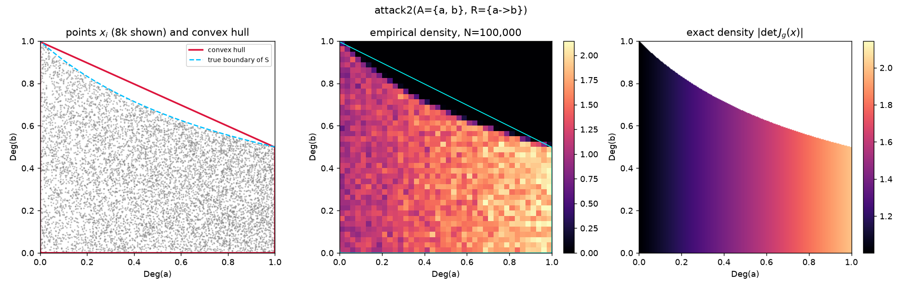

*$a\to b$. À gauche : points $x_i$, enveloppe convexe (rouge) et vraie frontière de $S$ (pointillés).
Au centre : densité empirique. À droite : densité exacte $1+x_a$.*

1. **$S$ n'est pas convexe dès qu'il y a une attaque.** Les contraintes $x_a+x_ax_b\le1$ sont
   bilinéaires. Pour $a\to b$, la frontière $x_b=1/(1+x_a)$ est une fonction convexe, et la région
   située sous elle n'est pas convexe (figure ci-dessus). L'enveloppe est alors le trapèze
   $(0,0),(1,0),(1,\tfrac12),(0,1)$, d'aire $3/4$, contre $\ln 2$ pour $S$. On a donc
   **7,6 % de volume vide** en théorie, 7,3 % mesuré. L'enveloppe convexe *surestime* toujours
   l'ensemble des degrés atteignables.
2. **Le volume vide augmente avec la dimension** : 0 % sans attaque ($S$ est un cube), 2 à 7 % pour
   $|A|=2$, 11 à 14 % pour $|A|=3$, 11 à 17 % pour $|A|=4$, 17 à 19 % pour $|A|=5$ et 20 à 22 % pour
   $|A|=6$. Chaque argument attaqué ajoute une face creuse. L'auto-attaque seule donne l'intervalle
   $[0,\varphi^{-1}]$, qui est convexe, d'où seulement 2 % de vide pour `attack2_self`.
3. **Le volume de $S$ diminue vite avec le nombre d'attaques** : 1 sans attaque, $0{,}69$ avec une
   attaque, $0{,}27$ pour le graphe complet à 3, $0{,}11$ pour le complet à 4, $0{,}09$ pour
   `random6`. Les attaques *compriment* l'espace des degrés.
4. **Le coût explose avec la dimension.** Le nombre de sommets de l'enveloppe passe de ~20 (2D) à
   ~120 (3D), ~500 (4D), ~1 400 (5D) et ~3 200 (6D). Qhull passe de moins de 0,1 s à environ 8 s
   en 6D. Au-delà de 6 arguments, l'enveloppe en dimension pleine n'est plus praticable, et les
   projections 2D restent la seule visualisation exploitable.
5. **Les sommets de l'enveloppe sont des points rares.** Ce sont des coins du type « un argument à 1,
   ses attaquants à 0 », de faible densité. Avec peu d'échantillons, l'enveloppe empirique est donc
   plus petite que l'enveloppe de $S$ : à $N=5\,000$, on obtient même
   $\mathrm{vol(hull)}<\mathrm{vol}(S)$ en dimensions 5 et 6.

### 2.5 Analyse des cartes de densité

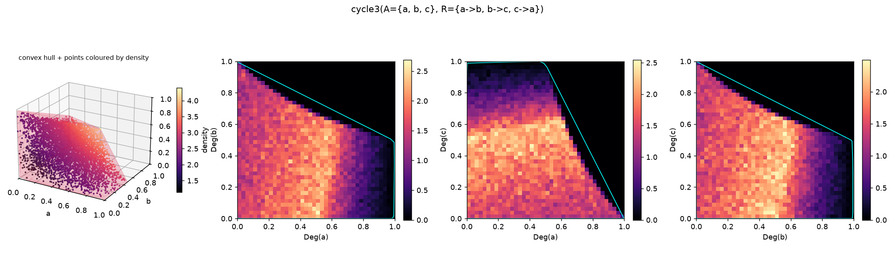

*Cycle $a\to b\to c\to a$ : enveloppe 3D et points colorés par la densité exacte (à gauche), puis
densité des trois projections 2D avec l'enveloppe projetée (en cyan).*

<p align="center">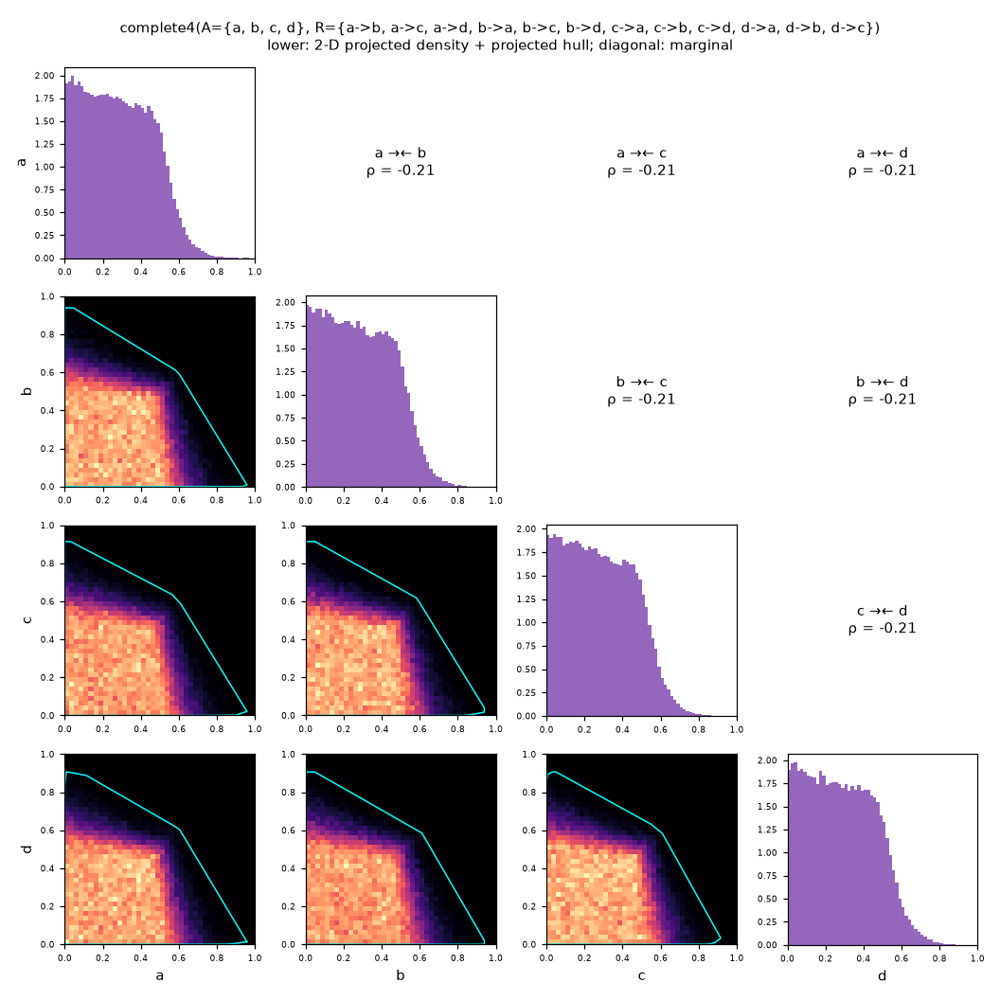</p>

*Graphe complet à 4 arguments. Sous la diagonale : densités projetées et enveloppe projetée. Sur la
diagonale : distributions marginales. Au-dessus : corrélations.*

1. **La densité est forte là où l'attaquant est fort.** Pour $a\to b$, $p=1+x_a$, et la heat-map
   empirique reproduit le dégradé exact de 1 à 2 (figure de la section 2.4). Quand $\mathrm{Deg}(a)$
   est grand, tous les poids $w_b\in[0,1]$ sont ramenés dans l'intervalle plus court
   $[0,1/(1+x_a)]$, d'où une densité plus élevée. Les zones de forte densité sont les régions
   comprimées par les attaques. Les zones de faible densité sont celles où un argument attaqué garde
   un degré élevé, ce qui impose des attaquants faibles.
2. **Cycles et graphes complets : un plateau puis une chute brutale.** Pour le cycle à 3, la densité
   est maximale vers $\mathrm{Deg}(a)\approx 0{,}5$–$0{,}6$ et s'effondre au-delà d'environ $0{,}62$.
   Pour le graphe complet à 4, la masse se concentre dans $[0;0{,}6]^2$ et les marginales sont presque
   uniformes sur $[0;0{,}55]$. Les degrés supérieurs à $\varphi^{-1}\approx0{,}62$ demandent des
   adversaires faibles : l'enveloppe les englobe, mais ces régions sont presque vides. C'est la
   différence entre l'*atteignable* (l'enveloppe) et le *typique* (la heat-map).
3. **Les degrés moyens suivent la topologie.** Un argument non attaqué a un degré moyen de $0{,}5$.
   Un argument attaqué par un argument non attaqué a un degré moyen de $\tfrac12\ln 2=0{,}347$
   (observé : $0{,}3465$). Dans une chaîne, les degrés moyens oscillent ensuite autour de
   $0{,}37$–$0{,}38$, et tous les arguments d'un cycle sont vers $0{,}373$. Dans les graphes complets,
   la moyenne baisse avec le nombre d'attaquants ($0{,}32$ pour 3 arguments, $0{,}28$ pour 4).
4. **Les attaques mutuelles créent une corrélation négative** ($\rho=-0{,}21$ entre chaque paire dans
   `complete4`) : un argument fort affaiblit son adversaire.
5. **La densité maximale augmente fortement avec $|R|$** : 2 pour une attaque, $6{,}6$ pour
   `complete3`, $22{,}7$ pour `complete4`, 41 pour `random6`. La masse se concentre dans une partie
   de plus en plus petite d'un espace lui-même de plus en plus petit.

### 2.6 Résilience au ré-échantillonnage

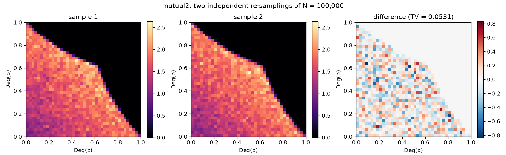

*$a\leftrightarrow b$ : deux échantillons indépendants de $N=100\,000$ points et leur différence, qui
ne montre que du bruit sans structure spatiale.*

<p align="center">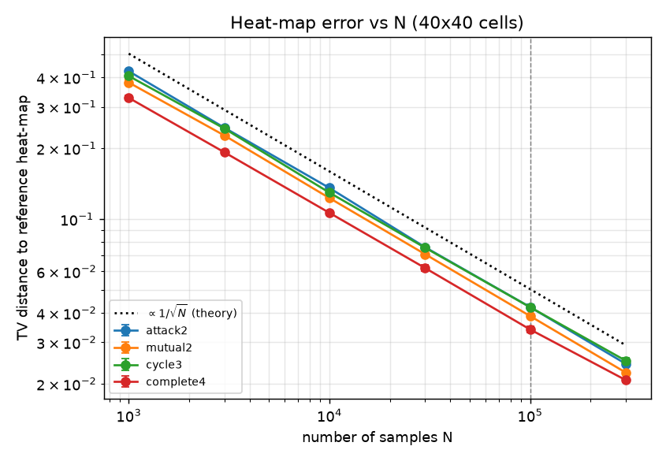</p>

*Distance TV entre la heat-map et une référence, en fonction de $N$. La référence est la densité exacte
intégrée par case pour les frameworks à 2 arguments, et un échantillon de 2 millions de points sinon.
La pente vaut $-1/2$.*

1. **La structure macroscopique est stable.** Deux tirages de 100 000 points donnent des heat-maps
   visuellement identiques, et leur différence n'est que du bruit blanc. La TV moyenne entre
   ré-échantillonnages reste entre $0{,}047$ et $0{,}071$ pour tous les frameworks.
2. **L'erreur décroît en $1/\sqrt N$.** La TV passe de $\approx0{,}4$ ($N=10^3$) à $\approx0{,}04$
   ($N=10^5$) puis $\approx0{,}024$ ($N=3\cdot10^5$), avec une pente $-1/2$ en échelle log-log, comme
   prévu pour un bruit multinomial.
3. **Le volume de l'enveloppe est très stable** : son coefficient de variation va de 0,05 % à 0,8 %.
   Il est un peu plus élevé en grande dimension, parce que les sommets sont des points rares.
4. **Le détail d'une case reste bruité.** Une case dense contient 60 à 150 points, soit un bruit
   relatif de 8 à 13 %. L'écart relatif maximal entre deux tirages, sur les 1 600 cases, atteint 60 à
   90 %, et la zone de forte densité (HDR50) ne se recouvre qu'à 47–66 % (indice de Jaccard). La raison
   est que les sommets de densité sont des plateaux : le bruit change le classement de cases de
   densité presque égale. Les *formes* des zones sont robustes, pas leurs contours case par case.
5. **Recommandations.** Une grille 40×40 avec $N=100\,000$ suffit pour lire les zones de forte et
   faible densité. Pour des contours fins, il faut augmenter $N$, utiliser des cases plus grosses
   (l'erreur varie comme $\sqrt{\text{nb cases}/N}$) ou un lissage (KDE). On peut aussi utiliser
   directement la densité exacte $\lvert\det J_g\rvert$ de la proposition, qui ne dépend d'aucun tirage.

---

## 3. Conclusion

- Le weighted h-categorizer s'implémente efficacement de façon vectorisée. Il converge en un nombre
  fini d'étapes sur les graphes acycliques, et géométriquement (taux de $0{,}38$ à $0{,}56$) sur les
  graphes cycliques. $\varepsilon$ contrôle directement l'erreur finale.
- L'espace des degrés atteignables admet une description exacte, $x_a(1+\sum_{b\to a}x_b)\le1$, avec
  une densité $\lvert\det J_g\rvert$. Cela permet de valider les visualisations.
- L'enveloppe convexe résume bien l'étendue de $S$, mais elle la surestime de 7 % à 22 % parce que
  $S$ n'est pas convexe, et son coût la limite à environ 6 arguments.
- La heat-map montre ce que l'enveloppe ne montre pas : la masse se concentre là où les attaques
  compriment les degrés, et une grande partie de l'enveloppe est presque vide. Cette information est
  robuste au ré-échantillonnage, avec une erreur en $1/\sqrt N$ d'environ 4 % pour $N=100\,000$.

**Référence.** L. Amgoud, J. Ben-Naim, D. Doder, S. Vesic. *Acceptability Semantics for Weighted
Argumentation Frameworks*. IJCAI 2017, p. 56–62.

---

## Annexe : figures pour l'ensemble des frameworks

### Frameworks à 2 arguments

*Sans attaque, attaque mutuelle, et $a\to b$ avec auto-attaque de $b$.*

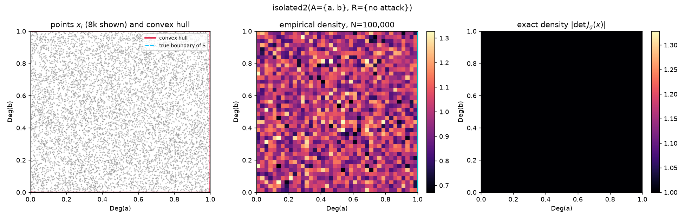
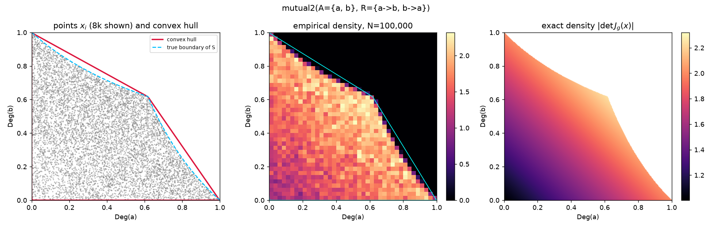
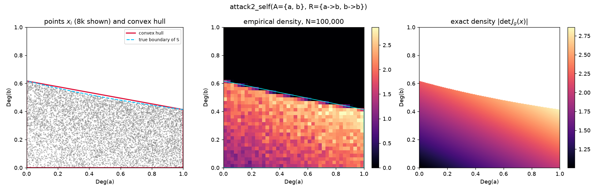

### Frameworks à 3 arguments

*Chaîne, étoile et graphe complet à 3 arguments.*

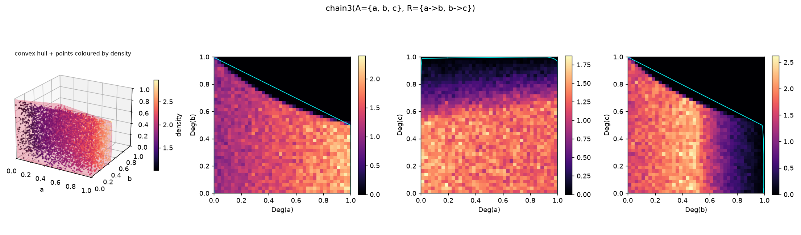
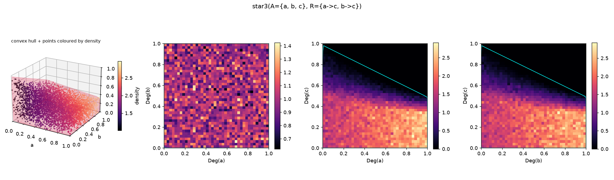
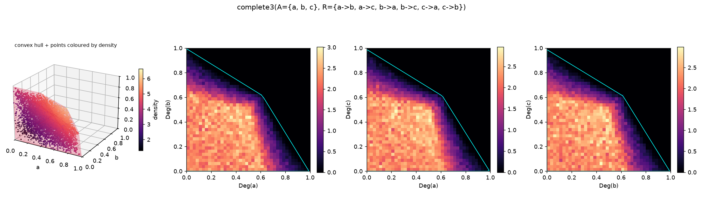

### Frameworks à 4 arguments

*Chaîne, cycle et graphe aléatoire ($p=0{,}4$). Le graphe complet est en section 2.5.*

<p align="center">
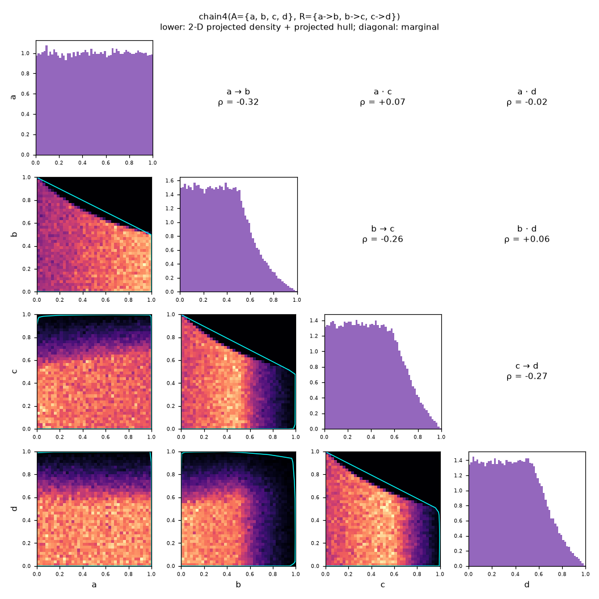
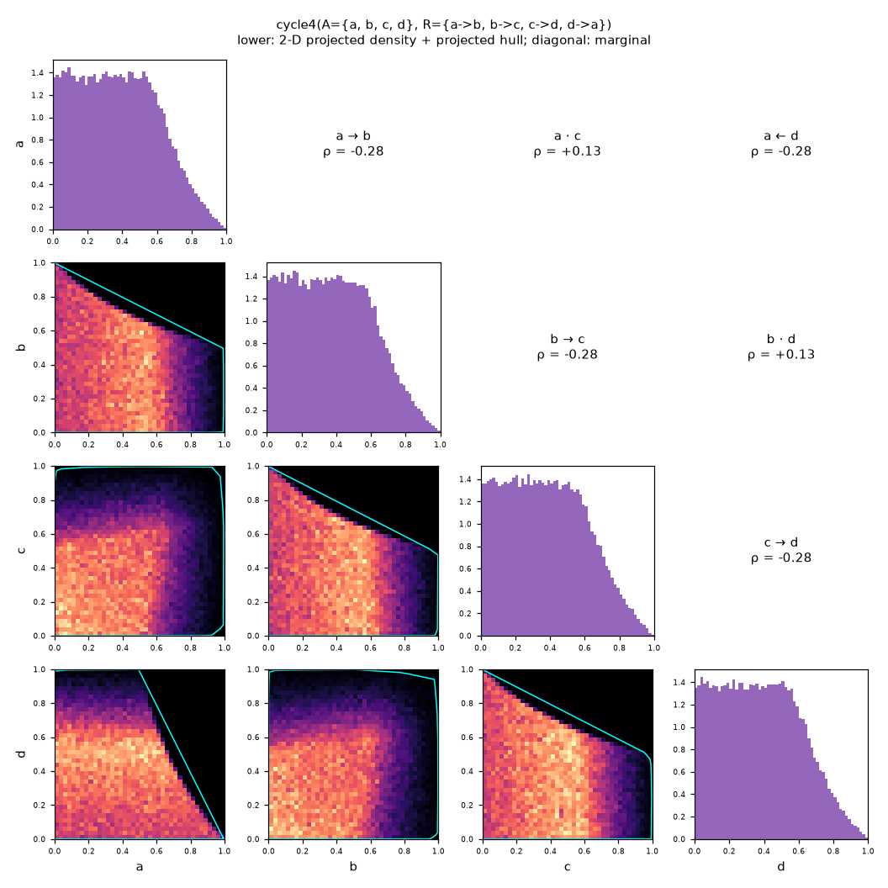
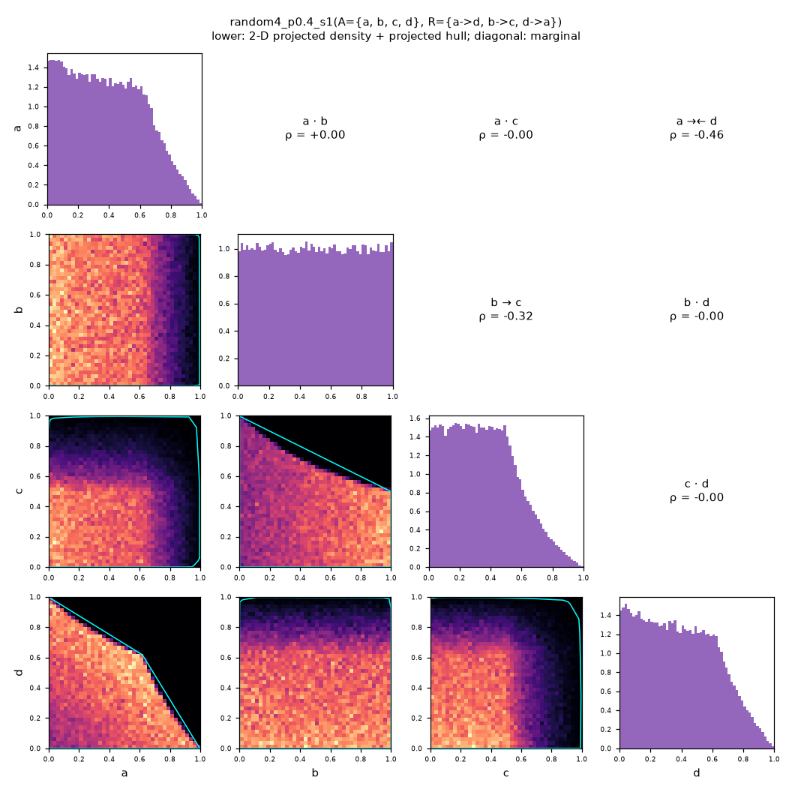
</p>

### Frameworks à 5 arguments

*Chaîne, cycle et graphe aléatoire ($p=0{,}3$).*

<p align="center">
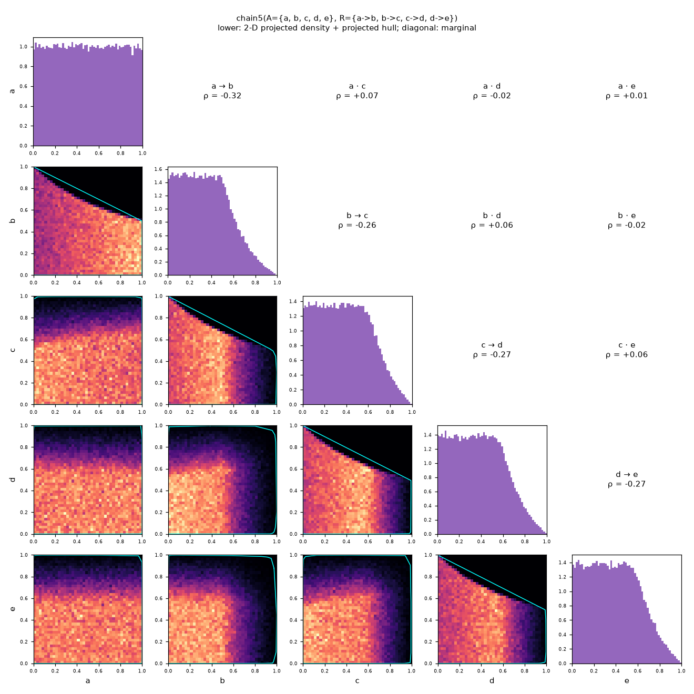
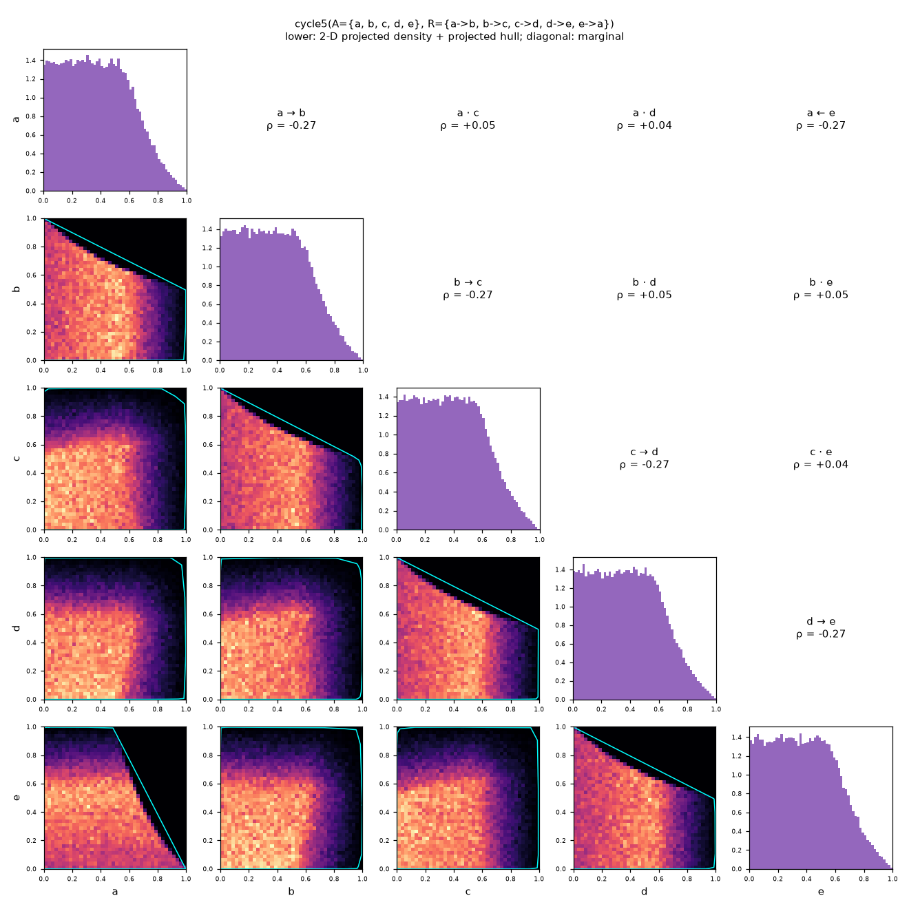
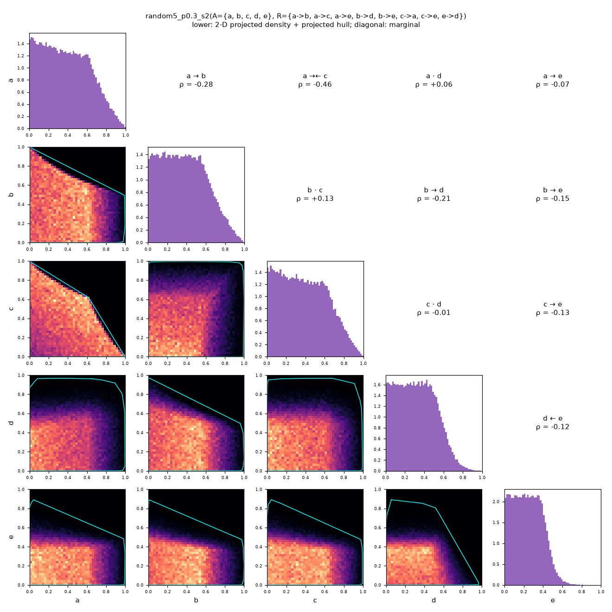
</p>

### Frameworks à 6 arguments

*Cycle et graphe aléatoire ($p=0{,}3$).*

<p align="center">
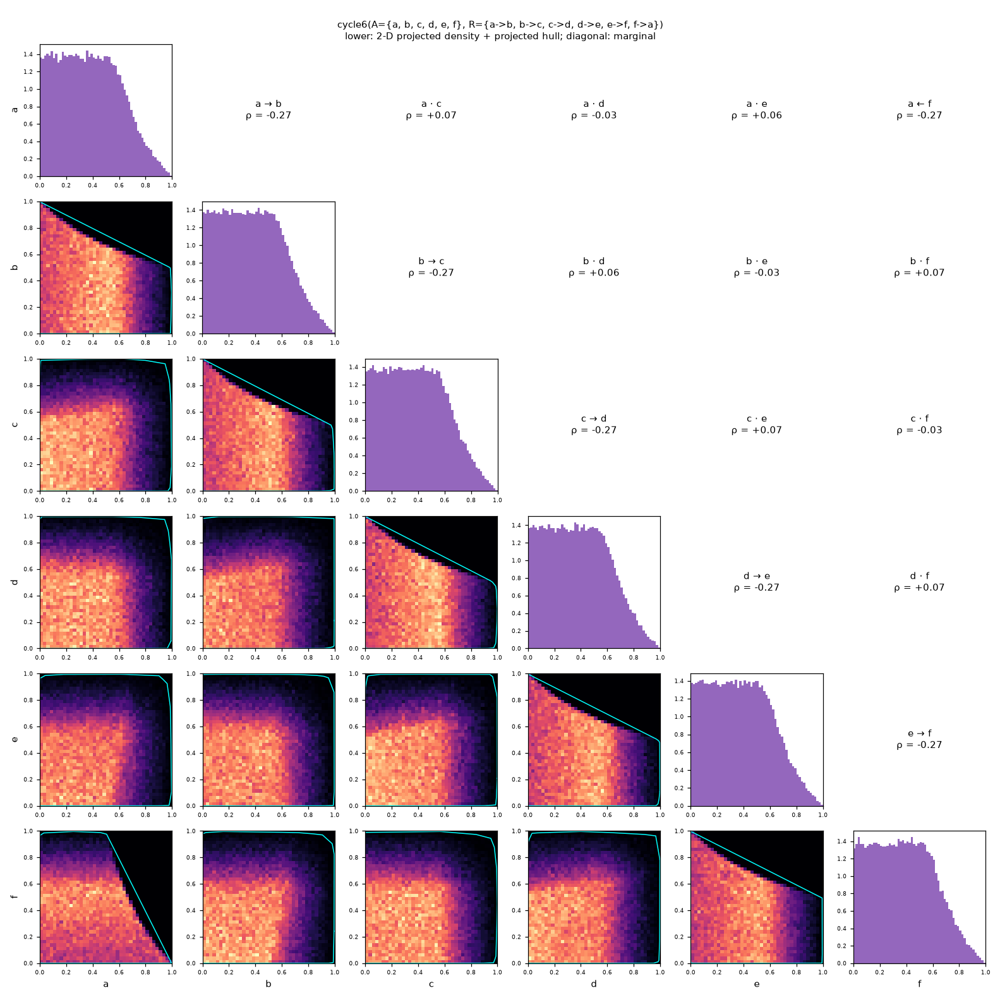
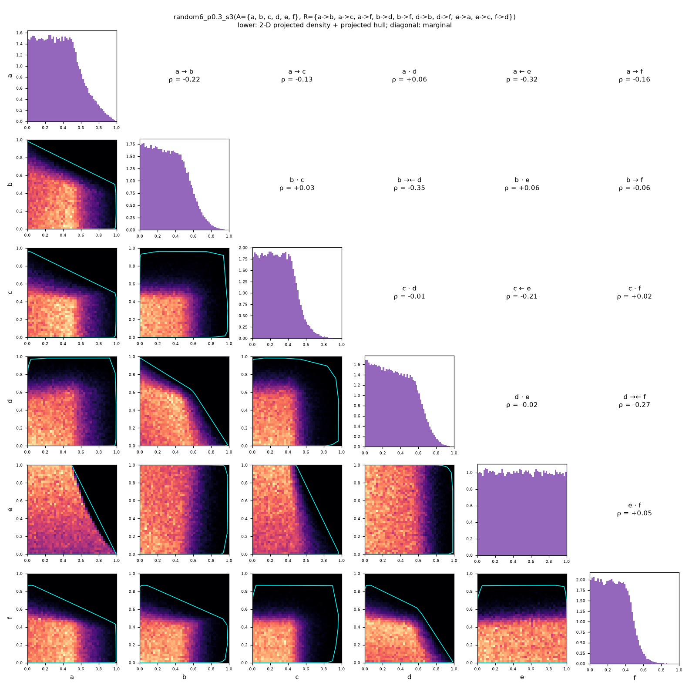
</p>

### Ré-échantillonnage

*Deux ré-échantillonnages indépendants et leur différence, pour $a\to b$ et le cycle à 3.*

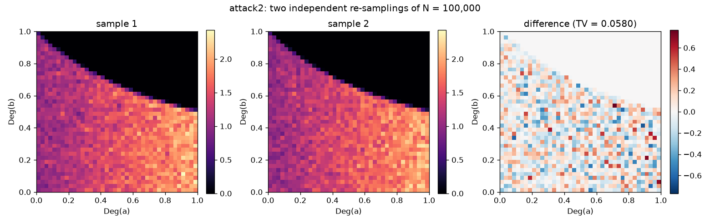
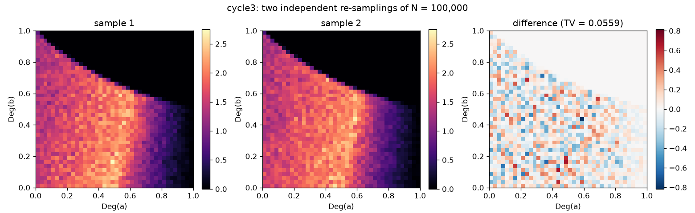
